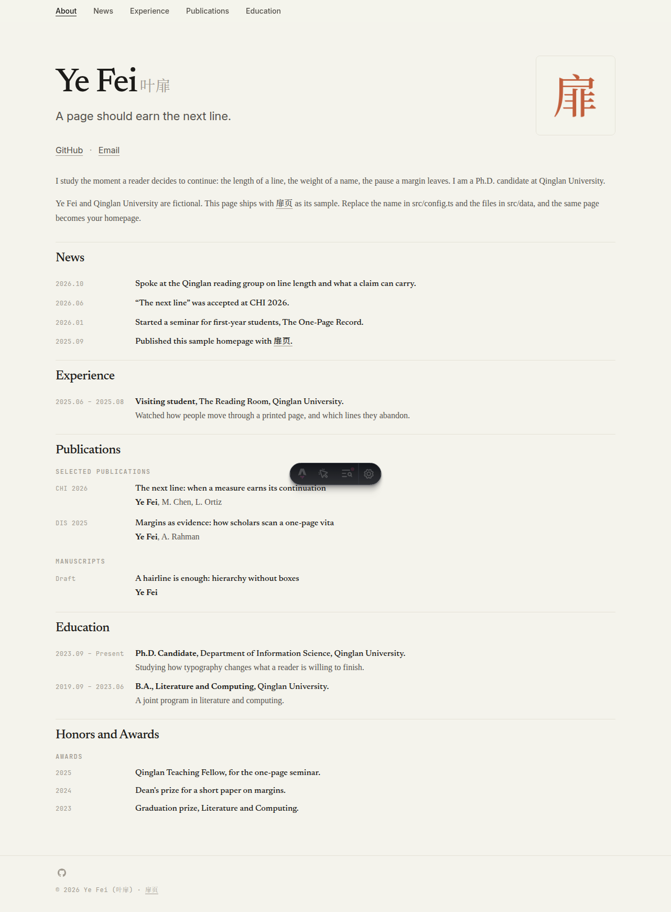

# 扉页 (Feiye)

[English](./README.en.md) · [简体中文](./README.md)

A one-page academic homepage. The GitHub repository stays [`astro-academic`](https://github.com/MaxwelsDonc/astro-academic).

Serif for the writing, monospace for the dates, ivory paper. No cards, no blog. Edit one config file and a set of JSON files, push to GitHub Pages, and you have a homepage.

**Live demo:** [zhouzenghui.site](https://zhouzenghui.site)

[](./LICENSE)
[](https://astro.build)
[](https://pages.github.com)




---

## Contents

- [Features](#features)
- [Quick start](#quick-start)
- [Project layout](#project-layout)
- [Configuration](#configuration)
- [Citation counts](#citation-counts)
- [Fonts](#fonts)
- [Custom domain](#custom-domain)
- [Documentation](#documentation)
- [License](#license)

---

## Features

- **One-page academic homepage** — About, News, Experience, Publications, Education, and more, each toggled on or off
- **Fluid type** — name, subtitle, and portrait scale together; there is no hard layout swap at 768px
- **Section-aware nav** — the header highlights the section in view and jumps via anchors
- **Optional citations** — off by default; the sample never requests anyone else’s Scholar stats
- **Self-hosted fonts** — Newsreader, Inter, and JetBrains Mono under the SIL OFL; no external font CDN
- **Content separated from chrome** — day-to-day edits stay in `src/config.ts` and `src/data/`

## Quick start

1. Click **Use this template** on GitHub. Name the new repository `your-username.github.io` (a user site served from `/`; you do not need to change `base`).
2. Edit `src/config.ts`: name, `site.url`, email. Leave `analyticsId` empty until you have your own id. Set the same URL in `astro.config.mjs`.
3. Replace `public/images/profile.jpg` with your photo. The file in this repo is a character mark, not a photograph.
4. Rewrite `src/data/` and `src/data/intro.md`. Ye Fei, Qinglan University, and the sample papers are fictional — they only give the layout something to hold.
5. Push `main`. GitHub Actions deploys to GitHub Pages.

Local commands:

```bash
npm install
npm run dev    # http://localhost:4321
npm run build
```

The footer links back to this template by default. Set `site.showTemplateCredit` to `false` to remove it.

## Project layout

```text
├── public/
│   ├── fonts/              # Self-hosted OFL fonts
│   └── images/             # Portrait, previews, favicons
├── src/
│   ├── components/         # Header, Hero, Section, Footer, …
│   ├── data/               # Content: JSON + intro.md
│   ├── pages/index.astro   # The only page
│   ├── styles/global.css   # Design system
│   └── config.ts           # Site and author settings
├── docs/CONTENT.md         # Field reference
└── .github/workflows/      # Pages deploy and optional Scholar crawler
```

## Configuration

The main knobs live in `src/config.ts`.

| Field | Purpose |
|------|---------|
| `site.title` | Browser title. Must not stay as `Your Name` |
| `site.url` | Your Pages URL, no trailing slash, and must not contain `yourname` |
| `site.analyticsId` | Google Analytics. `""` disables it |
| `site.showTemplateCredit` | Whether the footer keeps the 扉页 link |
| `author.github` | Username, or `owner/repo` |
| `author.email` | Empty string hides it; the address is Base64 in the HTML, not plain text |
| `homePage.sections` | Per-section on/off switches |
| `googleScholar.enabled` | Citation counts; default `false` |

Empty social fields do not appear under the name.

## Citation counts

Off by default. To turn them on:

1. Store your Google Scholar user id as the repository secret `GOOGLE_SCHOLAR_ID`
2. Wait for `.github/workflows/google_scholar_crawler.yaml` to push JSON to the `google-scholar-stats` branch
3. Set `googleScholar.enabled` to `true` in `src/config.ts` and point `statsUrl` at your own jsDelivr URL:

```text
https://cdn.jsdelivr.net/gh/USER/REPO@google-scholar-stats/gs_data.json
```

4. Add a `paperId` on each paper entry

Full steps are in [`docs/CONTENT.md`](docs/CONTENT.md).

## Fonts

Font files ship in the repo. The built site does not load fonts from an external host.

| Font | Role | Copyright |
|------|------|-----------|
| Newsreader | Body text | Copyright 2020 The Newsreader Project Authors |
| Inter | Small UI labels | Copyright 2016 The Inter Project Authors |
| JetBrains Mono | Dates, nav, tags | Copyright 2020 The JetBrains Mono Project Authors |
| Noto Serif SC subset | Only 叶, 扉, and 页 in the sample | Copyright 2017–2024 Adobe |

All of the above are under the [SIL Open Font License 1.1](https://openfontlicense.org). The OFL is **not** merged into the MIT license: you may redistribute these fonts with the template, but you may not relicense the fonts themselves. Full texts are in `public/fonts/*-OFL.txt`.

After you replace the sample Chinese name, the page falls back to the reader’s system songti; only those three sample characters use the Noto subset.

## Custom domain

Create `public/CNAME` with your domain and point DNS at `<username>.github.io`. This repository does not ship a CNAME.

## Documentation

| Doc | What it covers |
|-----|----------------|
| [`docs/CONTENT.md`](docs/CONTENT.md) | News, papers, experience fields and examples |
| [`AGENTS.md`](AGENTS.md) | Architecture and design rules for coding agents |
| [`LICENSE`](./LICENSE) | Full MIT text |

Xiaohongshu cover art: [`public/images/xiaohongshu.png`](public/images/xiaohongshu.png)

## License

[MIT](./LICENSE). Copyright (c) 2022 Yi Ren. Copyright (c) 2026 Zhou Zenghui.

The original academic theme was written by Yi Ren. This one-page version was redesigned by Zhou Zenghui. Keep both notices if you redistribute the code. Fonts remain under the SIL OFL, as noted above.
