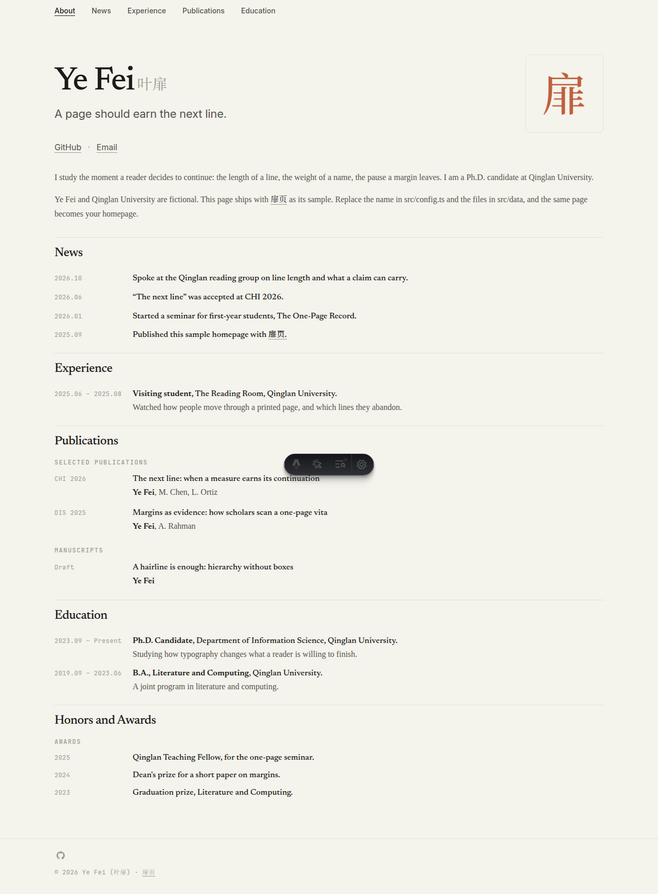

# 扉页

一页纸的学术主页。仓库名保持 [`astro-academic`](https://github.com/MaxwelsDonc/astro-academic)。

衬线写内容，等宽写日期，象牙色的纸，没有卡片，也没有博客。改一份配置和一组 JSON，推上 GitHub Pages，就是你的主页。

做好的一页在这里：[zhouzenghui.site](https://zhouzenghui.site)




小红书封面：[`public/images/xiaohongshu.png`](public/images/xiaohongshu.png)

---

## 做成你的主页

1. 在 GitHub 上点 **Use this template**。新仓库用 `你的用户名.github.io`，这是用户站，站点从 `/` 提供，不用改 `base`。
2. 编辑 `src/config.ts`：名字、`site.url`、邮箱。`analyticsId` 留空，用你自己的统计编号再填。`astro.config.mjs` 里的 `site` 改成同一个网址。
3. 用你的照片换掉 `public/images/profile.jpg`。仓库里这张是「扉」字，不是照片。
4. 改 `src/data/` 里的 JSON 和 `intro.md`。叶扉、青澜大学和那几篇论文都是虚构的，用来把版式撑开。
5. 推到 `main`。GitHub Actions 会部署到 GitHub Pages。

```bash
npm install
npm run dev    # http://localhost:4321
npm run build
```

字段、论文、新闻的写法在 [`docs/CONTENT.md`](docs/CONTENT.md)。

页脚有一条「扉页」链回本仓库。不想留，把 `site.showTemplateCredit` 设为 `false`。

## 这页里已经有的

- 名字、副标题和照片是一组，宽度变化时一起缩放，没有在 768px 突然换一版布局。
- 顶栏标出你正在看的那一节。
- 引用数默认关闭，页面不会去请求别人的引用统计。
- 字体放在仓库里：Newsreader、Inter、JetBrains Mono，授权是 SIL OFL，全文在 `public/fonts/*-OFL.txt`。示例名字里的「叶」「扉」「页」另有一个很小的 Noto Serif SC 子集，换上你自己的中文名后，会改用读者电脑上的宋体。

## 配置

都在 `src/config.ts`。

| 字段 | 作用 |
|------|------|
| `site.title` | 浏览器标题。不能留成 `Your Name` |
| `site.url` | 你的 Pages 地址，不要带末尾斜杠，也不能包含 `yourname` |
| `site.analyticsId` | Google Analytics。`""` 表示关闭 |
| `site.showTemplateCredit` | 页脚是否保留「扉页」 |
| `author.github` | 用户名，或 `owner/repo` |
| `author.email` | 留空则不显示。页面上的地址是 Base64，不写在静态 HTML 里 |
| `homePage.sections` | 每一节的开关 |
| `googleScholar.enabled` | 默认 `false` |

空字符串的社交字段不会出现在名字下面。

## 引用数

默认关着。要打开：把 Scholar 的 user id 存成仓库密钥 `GOOGLE_SCHOLAR_ID`，等 `.github/workflows/google_scholar_crawler.yaml` 把 JSON 推到 `google-scholar-stats` 分支，然后在 `src/config.ts` 里打开 `googleScholar.enabled`，并填上你自己的 jsDelivr 地址：

```
https://cdn.jsdelivr.net/gh/USER/REPO@google-scholar-stats/gs_data.json
```

再给论文加上 `paperId`。说明写在 `docs/CONTENT.md`。

## 字体

自托管，不从外部字体站加载。

| 字体 | 用途 | 版权 |
|------|------|------|
| Newsreader | 正文 | Copyright 2020 The Newsreader Project Authors |
| Inter | 少量界面文字 | Copyright 2016 The Inter Project Authors |
| JetBrains Mono | 日期、导航、标签 | Copyright 2020 The JetBrains Mono Project Authors |
| Noto Serif SC 子集 | 只含示例里的「叶」「扉」「页」 | Copyright 2017–2024 Adobe |

三份都是 [SIL Open Font License 1.1](https://openfontlicense.org)。OFL 不并入 MIT：可以随模板分发这些字体，不能把字体本身改成别的许可证。

## 定制域名

建一个 `public/CNAME`，写上你的域名，DNS 指到 `<username>.github.io`。这个仓库不带 CNAME。

---

## English

**扉页** (Feiye, “flyleaf”) is a one-page academic homepage. The GitHub repository stays `astro-academic`.

Serif for the writing, monospace for the dates, ivory paper, no cards, no blog. A finished site built from this template: [zhouzenghui.site](https://zhouzenghui.site).

### Start

1. **Use this template**. Name the new repository `your-username.github.io` so it is a user site served from `/`.
2. Edit `src/config.ts` (name, `site.url`, email). Leave `analyticsId` empty until you have your own id. Set the same URL in `astro.config.mjs`.
3. Replace `public/images/profile.jpg`. The file here is a character, not a photograph.
4. Replace `src/data/` and `src/data/intro.md`. Ye Fei, Qinglan University, and the papers are fiction, so the layout has something to hold.
5. Push `main`. GitHub Actions deploys to GitHub Pages.

```bash
npm install
npm run dev
npm run build
```

See [`docs/CONTENT.md`](docs/CONTENT.md). Set `site.showTemplateCredit` to `false` to drop the footer link.

Citation counts are off, and the sample does not request anyone else’s stats. Fonts in `public/fonts/` are self-hosted under the SIL OFL; the MIT license below does not relicense them. The characters 叶, 扉, and 页 ship as a small Noto Serif SC subset so the sample name has a serif. Any other Chinese text uses the reader’s own songti.

## License

MIT. Copyright (c) 2022 Yi Ren. Copyright (c) 2026 Zhou Zenghui.

The original academic theme was written by Yi Ren. This one-page version was redesigned by Zhou Zenghui. Keep both notices if you redistribute the code.
