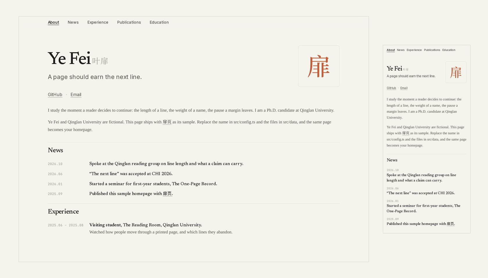

# 扉页

[English](./README.en.md) · **简体中文**

给学者的一页纸。姓名、介绍、动态与论文，顺着读完就够——像书前那页扉页，而不是后台里的仪表盘。

衬线写正文，等宽写日期；象牙色的纸，没有卡片，也没有博客要喂。改一份配置、一组 JSON，推上 GitHub Pages，主页就在线。

<p align="center">
  <a href="https://zhouzenghui.site"><strong>看成品 → zhouzenghui.site</strong></a>
  &nbsp;·&nbsp;
  <a href="https://github.com/MaxwelsDonc/feiye/generate"><strong>Use this template</strong></a>
</p>

<p align="center"><sub>成品站与模板共用同一套版式；站上履历是作者本人的，仓库里叶扉与青澜大学是虚构样例。</sub></p>

<p align="center">
  
</p>

<p align="center"><sub>宽屏展开，窄屏收束；字号与留白跟着视口走，不会在某个宽度突然换一副面孔。</sub></p>

## 这页里有什么

- **一页说完** — About、News、论文、经历等章节按需开关，没有博客负担  
- **改数据，不改架子** — 日常只动 `src/config.ts` 与 `src/data/`  
- **流体排版** — 姓名、副标题与照片一起伸缩，不用两套布局硬切  
- **顶栏知所在** — 锚点导航，当前章节会亮起来  
- **推上去就发布** — `main` 一经推送，GitHub Actions 部署到 Pages  
- **引用自己长** — Scholar 爬虫按日跑；结果写在独立分支 `google-scholar-stats`，不动你的站点源码  
- **字在仓库里** — Newsreader、Inter、JetBrains Mono，SIL OFL，不求外链字体站  
- **其余从简** — Analytics、自定义域名、页脚署名皆可关；邮箱经 Base64，空着的社交链接不会出现  

## 做成你的

1. **[Use this template](https://github.com/MaxwelsDonc/feiye/generate)**，仓库名用 `你的用户名.github.io`  
2. 在 `src/config.ts` 写下姓名、`site.url`、邮箱；`astro.config.mjs` 里的 `site` 写成同一个网址  
3. 用你的照片换掉 `public/images/profile.jpg`  
4. 改写 `src/data/` 与 `intro.md`  
5. 推送 `main`

```bash
npm install
npm run dev    # http://localhost:4321
npm run build
```

## 关于引用数

示例默认关掉，页面不会去敲任何人的 Scholar。

若要打开：把 Scholar 的 user id 存成密钥 `GOOGLE_SCHOLAR_ID`，启用 Actions。工作流会把 JSON **推到分支 `google-scholar-stats`**（不是 `main`）。再在配置里打开 `googleScholar.enabled`，填上你的 jsDelivr 地址，并给论文加上 `paperId`。

```text
https://cdn.jsdelivr.net/gh/USER/REPO@google-scholar-stats/gs_data.json
```

写法与字段见 [`docs/CONTENT.md`](docs/CONTENT.md)。顶栏链接宜少——大约五六项，手机上更干净。页脚那条「扉页」不想留，设 `site.showTemplateCredit = false` 即可。
